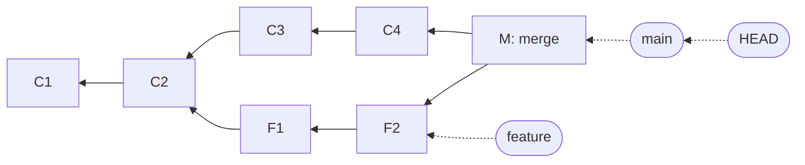
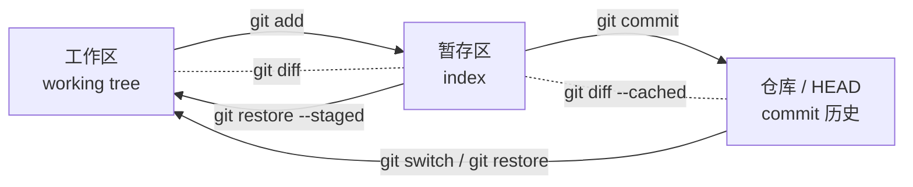
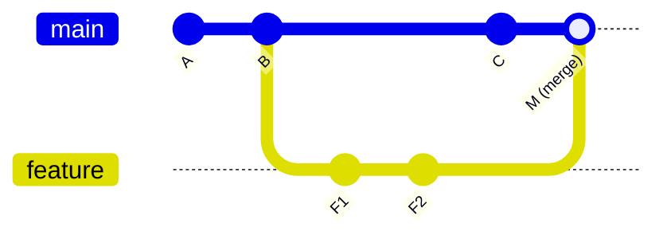

# 项目是由原子变更推进的快照：从 jyy《生成式软件工程》第三讲看 Git

> “Git 管理项目的快照。”
> “项目是由原子变更推进的快照，可以分支，可以合并。”
> —— 蒋炎岩，《生成式软件工程》2026 秋，第 3 讲《版本管理》

第三讲开场，jyy 讲了自己在保研面试里问过的三个问题：什么是 Git？什么是 `git rebase`？`git merge` 冲突以后你会看到什么？第一个问题多数人还能说上几句；被问到 rebase 的十位同学，一个都没答出来；至于冲突，没有人主动说出“冲突双方的内容和 `<<<<<<<` 标记会直接写进工作区的文件里”。

他想说明的不是大家背少了几个术语，而是**用过一个工具，不等于观察过它做了什么**。“知道 Git 是版本管理工具”和“能预测下一条命令会改变什么”，中间隔得很远。

这篇讲解想补上这一段距离。思路借用 MIT 的 Missing Semester：先讲数据模型，再讲命令。原因他们说得很直白，Git 的命令行是一个漏的抽象（leaky abstraction），丑陋的界面只能背，漂亮的设计却能理解。对学数学的人来说，这条路尤其顺：Git 的核心就是几种对象、一张有向无环图和一组可变指针，所有命令都只是在图上加节点、挪指针。

---

## 一、为什么要版本管理：从“我想撤销”出发

jyy 的切入点很朴素。一个软件项目就是一个目录：需求说明表达意图（Intent），接口文档和测试描述规格（Spec），源代码承担实现（Impl），构建脚本把它们组织起来。做课程作业时，事情往往到这里就结束了。他举了自己第一个博士生的例子：大一时代码存在优盘上，优盘坏了，代码也就没了。

就算优盘不坏，问题也还在：

- 昨天能跑，今天改坏了，怎么回去？
- 一个功能改到一半，突然要修另一个 bug，怎么把手头的东西先放下？
- 你和同学从同一份代码出发各改了一些文件，怎么把结果合起来？

最直接的办法是复制目录，起名“作业-v1”“作业-v2”“作业-最终版”。旧目录在，旧文件就找得回来；可版本一多，谁从哪份改来、哪个文件该配哪个配置，全得靠人记。版本管理工具就是把这些记忆工作接管过去：RCS 管单个文件的历史，CVS、SVN 围绕中心服务器协作，Git 则让每个开发者在本地拥有完整历史。Git 诞生于 2005 年的 Linux 内核社区：内核原本用 BitKeeper，那一年免费使用的安排结束，社区就开始写自己的工具。速度、大规模协作和分支，都是实际需求逼出来的。

Missing Semester 也列了几个现代版本控制系统能回答的问题：这个模块是谁写的？这一行是什么时候、被谁、为什么改的？过去一千个版本里，某个单元测试是从什么时候、因为什么开始挂的？这些问题都需要一个前提：**历史被结构化地记了下来**。

---

## 二、数据模型：三种对象、一张 DAG、一组指针

### 1. 快照，而不是补丁

jyy 说“最需要建立的概念”是：**Git 管理的是整个项目的快照**。快照记录的是纳入版本管理的所有文件在某一时刻的内容和目录位置。

为什么以整个项目为单位？因为源代码、接口和配置经常一起变。如果只把几个源文件恢复到旧版本，却留着新的配置，就可能拼出一个历史上从来没有正常运行过的版本。

Missing Semester 用三种类型把快照写得很清楚：

```
// 文件就是一串字节
type blob = array<byte>

// 目录把名字映射到文件或子目录
type tree = map<string, tree | blob>

// 提交 = 父提交 + 元信息 + 顶层目录树
type commit = struct {
    parents: array<commit>
    author: string
    message: string
    snapshot: tree
}
```

- **blob**：文件内容本身，注意它不含文件名。
- **tree**：目录，把名字映射到 blob 或子 tree，所以目录可以嵌套。
- **commit**：一个快照（顶层 tree）加上作者、说明和**父提交的集合**。

### 2. 内容寻址：对象的名字就是它的哈希

三种东西统称为对象（object），全部按哈希存储：

```
objects = map<string, object>

def store(object):
    id = sha1(object)
    objects[id] = object
```

这就是内容寻址（content-addressing）。对象的 ID 由它的内容决定。Pro Git 第 10 章补充了细节：哈希的输入是“类型头 + 内容”，比如一个 blob 的头是 `blob <字节数>\0`。可以自己验证：

```bash
$ echo hello | git hash-object --stdin
ce013625030ba8dba906f756967f9e9ca394464a
$ printf 'blob 6\0hello\n' | sha1sum
ce013625030ba8dba906f756967f9e9ca394464a  -
```

两个结果一模一样，Git 没有任何魔法。（默认算法是 SHA-1，新版 Git 也支持用 SHA-256 作对象格式。）

内容寻址带来三个后果，都值得用数学的眼光看一眼：

1. **相同内容只存一份。** 一千次提交里某个文件从没变过，它对应的 blob 就始终是同一个哈希、同一份存储。jyy 的说法是“逻辑上是完整快照，存储上可以共享数据”。
2. **对象不可变。** 改一个字节，哈希就变，那已经是另一个对象。Missing Semester 强调：commit 是不可变的，所谓“修改历史”，其实是新建了一批 commit，再把引用指过去。
3. **哈希链接构成默克尔结构（Merkle DAG）。** commit 存的是 tree 的哈希和父 commit 的哈希，所以一个 commit 的 ID 间接锁定了整个项目的内容和全部祖先。两个仓库里 commit ID 相同，就可以认为两段历史完全相同。

### 3. 历史是一张有向无环图（DAG）

每个 commit 指向自己的父提交。一般只有一个父；merge 产生的提交有两个父。于是历史不是一条链表，而是一张 DAG。注意箭头方向：它指向父提交，表示“来自”，不是“下一个”。



用数学语言讲：commit 集合上的“祖先关系”是一个偏序，DAG 是它的哈斯图（Hasse diagram）的一种表示。两个分支的**共同祖先**，就是两个元素公共下界里最“近”的那个（merge-base）。下面讲三方合并时会用到它。

### 4. 引用：唯一可变的东西

40 位十六进制谁都记不住，所以 Git 加了一层人类可读的名字，叫**引用（reference）**：

```
references = map<string, string>   // 名字 -> commit 哈希
```

- **分支（branch）** 就是一个引用，比如 `main` 指向某个 commit。在分支上提交，分支引用就往前挪到新 commit 上。创建分支只是多写一个几十字节的文件，所以几乎零成本。
- **HEAD** 是“我现在在哪”，通常指向当前分支（Pro Git 的说法是“指向当前分支引用的指针”），新 commit 的父提交就由它决定。HEAD 直接指向某个 commit 而不是分支时，叫 detached HEAD。
- **标签（tag）** 是不会挪动的引用，用来标版本号。

于是 Missing Semester 给出了一个非常干净的定义：**仓库 = 对象 + 引用**。磁盘上 `.git` 里存的基本就是这两样（`.git/objects/` 和 `.git/refs/`）。每条命令都可以翻译成“往对象库里加了什么，挪了哪个引用”。他们的建议是：敲任何命令之前，先想它对底层的图做了什么；反过来，想对图做某种操作时，几乎总有一条命令能做到。

---

## 三、三个区域：工作区、暂存区、仓库

数据模型里没有“暂存区”，它是 Git 为了**组织提交**而加的一层界面。jyy 和 Pro Git 都把它当作理解日常操作的关键。

- **工作区（working tree）**：磁盘上你正在编辑的文件。
- **暂存区（index / staging area）**：下一次提交准备采用的内容清单，路径对应 blob 哈希。
- **仓库（repository）**：已经提交的快照历史，`HEAD` 指向其中当前那一个。

Pro Git 的《Reset Demystified》把它们叫作“三棵树”（HEAD、Index、Working Directory），并说明 Git 的日常工作流就是在这三棵树之间搬运内容，让快照一步步变得更好。



### jyy 留的那道题：add 之后又改，提交的是哪个版本？

jyy 课上特意说这道题“很值得亲手试”：先改 `hello.c`，`git add hello.c`，再改一次，最后 `git commit`，提交进去的是哪个版本？

答案是 **add 时的版本**。下面是真实运行的结果：

```bash
$ echo 'v1' > hello.c && git add hello.c
$ echo 'v2' > hello.c
$ git commit -m "add hello"
$ git show HEAD:hello.c      # 提交里的内容
v1
$ cat hello.c                # 工作区里的内容
v2
$ git status --short
 M hello.c                   # 工作区相对暂存区还有修改
```

从数据模型看，原因一目了然：**`git add` 的那一刻，Git 就把文件内容写成 blob 存进了对象库**，暂存区只记下“`hello.c` → 这个 blob 的哈希”。之后你在工作区怎么改，都不会影响已经写好的那个 blob。`git commit` 只是把暂存区固化成 tree，再包一层 commit。在空仓库里做完这一步，`.git/objects/` 里正好多出三个对象：一个 blob、一个 tree、一个 commit。

两条对应的观察命令：`git diff` 看**工作区 vs 暂存区**（还没 add 的修改），`git diff --cached` 看**暂存区 vs HEAD**（马上要提交的内容）。

为什么要多这一层？Missing Semester 举了两个场景：你同时写了两个功能，想拆成两个提交；或者修 bug 时到处加了调试用的 `print`，只想提交修复本身。暂存区让你挑出这次提交该有的内容，而不是把此刻所有编辑一股脑记下来（`git add -p` 甚至能按代码块挑）。jyy 的总结是：“暂存区让你能够组织一次提交的内容。”

---

## 四、命令 = 对图的操作

有了模型，每条命令都可以回答四个问题，这也正是 jyy 说的“操作前先预测”：**工作区会变吗？下一次提交包含什么？哪个引用会移动？历史里会多出什么关系？**

| 命令 | 对象库 | 引用 / HEAD | 工作区 / 暂存区 |
|---|---|---|---|
| `git init` | 建空的 `.git` | HEAD 指向一个还不存在的分支 | 不变 |
| `git add f` | 写入 f 的 blob | 不变 | 暂存区记下 f → blob |
| `git commit` | 写入 tree 和 commit（父 = HEAD 所指） | 当前分支前移到新 commit | 不变 |
| `git log` / `git diff` | 只读 | 只读 | 只读 |
| `git branch x` | 不变 | 新建引用 x，指向当前 commit | 不变 |
| `git switch x` | 不变 | HEAD 改指 x | 改成 x 的快照 |
| `git merge y` | 可能新建一个双父 commit | 当前分支前移 | 写入合并结果（或冲突） |
| `git rebase main` | 新建一串“重放”的 commit | 当前分支改指新串的末端 | 逐个重放 |
| `git reset --soft/--mixed/--hard C` | 不变 | 当前分支改指 C | soft 都不动；mixed 重置暂存区；hard 连工作区也重置 |
| `git stash` | 把未提交修改存成特殊 commit | 更新 `refs/stash` | 恢复到干净状态 |
| `git fetch` | 下载远端对象 | 更新 `origin/main` 这类远端跟踪引用 | 不变 |
| `git pull` | = fetch + merge（默认） | 同上，再前移当前分支 | 写入合并结果 |
| `git push` | 把对象传到远端 | 更新远端的分支引用 | 不变 |

几点说明：

- **`switch` / `checkout`**：老命令 `git checkout` 身兼两职，既切分支又恢复文件，容易混。新版 Git 拆成了 `git switch`（切换分支）和 `git restore`（恢复文件），Missing Semester 的命令清单里两者都列了。
- **`reset`**：Pro Git 把它拆成三步：第一步移动 HEAD 所指的分支（`--soft` 到此为止）；第二步让暂存区和它一致（`--mixed`，默认）；第三步让工作区也一致（`--hard`）。只有第三步会丢掉没提交的修改，所以 `--hard` 是少数真正危险的命令之一。
- **`remote` / `fetch` / `pull` / `push`**：远端仓库也就是另一组“对象 + 引用”。`fetch` 只是把对方的对象和引用拷过来，存成 `origin/main` 这样的远端跟踪分支，不碰你的工作；`pull` 默认等于 `fetch` 加 `merge`。Berkeley CS61B 的 Git 指南强调过 Git 是分布式的：每个开发者的电脑上都有完整历史，断网也能提交、看历史。

---

## 五、merge 与 rebase：两种汇合历史的方法

### merge：保留分叉

假设你和同学都从 A 出发，一个改界面，一个修解析器（这是 jyy 课上的例子）。`git merge` 找到两条线的**共同祖先**，对比“祖先→我”和“祖先→你”两份改动，再尝试把它们结合起来。这叫三方合并（three-way merge）。结果分两种：

- **fast-forward**：如果对方的分支就是你的直接后续（你这边没有新提交），Git 只需把分支引用往前挪，不产生新 commit。
- **merge commit**：两边都分叉前进了，就生成一个**有两个父提交**的新 commit，历史图上能看到分叉又汇合。

### rebase：重放成一条线

`git rebase main` 把你分支上的提交所代表的**改动**，一个个重放到 `main` 的最新位置之后。图上看起来就像你是在新主线上从头做的。关键在于：父提交变了，commit 内容就变了，哈希也跟着变。重放出来的 C′ 是新对象，原来的 C 还在对象库里，只是没有分支再指向它。



（上图是 merge 的结果。如果改用 rebase，F1、F2 会变成接在 C 后面的 F1′、F2′，历史是一条直线，没有 M。）

Pro Git 给 rebase 定了一条黄金规则：**不要 rebase 已经存在于你本地仓库之外、可能有人在其基础上工作的提交。** jyy 的表述是：rebase 适合在约定允许的范围内整理自己的工作；如果别人已经依赖原来的提交，你再改写它们，就会增加协作成本。

两者怎么选，没有统一答案。merge 如实记录发生过什么；rebase 让历史更好读，便于 `cherry-pick`、`blame` 和 `bisect`。jyy 补了一句很重要的话：**线性只是组织形式**。如果每一步都意义不明、不能运行，排成一条直线也不会自动变成好历史。

### 冲突：两边对同一处做了不兼容的修改

两边改了同一段文本、Git 无法自动协调时，它会**把双方的内容和冲突标记直接写进工作区的文件**，同时在 `git status` 里报告 `both modified`（短格式是 `UU`）。下面是照 Missing Semester 的“菜谱”练习真实跑出来的结果：

```text
<<<<<<< HEAD
1 cup salt
=======
2 cups sugar
>>>>>>> sweet
2 eggs
```

`<<<<<<< HEAD` 到 `=======` 是你当前分支的版本，`=======` 到 `>>>>>>>` 是被合并进来的版本。解决冲突就是读懂上下文，把文件改成最终应有的样子，删掉标记，`git add` 标记为已解决，再 `git commit`（或 `git merge --continue`）。jyy 提醒过，二进制文件、“一边删一边改”这类冲突不一定是这种文本标记，所以要**同时看状态和文件**。

第四讲里他又往前推了一步：冲突本质上是两边对共同状态做了不兼容的修改，工具只能发现**文本**上的分歧，到底要哪种行为得回到需求去判断。反过来，改动落在不同文件、文本上自动合并成功，组合起来也可能违背双方原来的假设。这一点到了 Agent 时代尤其要紧，见第八节。

---

## 六、常见坑与恢复：reflog 是安全网

先建立一个让人安心的事实：**提交过的东西很难真丢。** commit 不可变，`reset`、`rebase`、`commit --amend` 都只是新建对象、挪指针，旧 commit 还在对象库里。找回它的工具是 **reflog**：Git 会记下每个引用（包括 HEAD）每次移动到了哪里。

接着上面的例子，执行一次 `git reset --hard HEAD~1` 把 merge 提交“删掉”，再看 reflog：

```text
62ceffe HEAD@{0}: reset: moving to HEAD~1
352cb6f HEAD@{1}: commit (merge): merge sweet
62ceffe HEAD@{2}: merge salty: Fast-forward
cc1ed62 HEAD@{3}: checkout: moving from sweet to main
```

`git reset --hard 352cb6f`（或 `HEAD@{1}`）就能回去。reflog 是本地的，条目默认保留 90 天（`gc.reflogExpire`，引自 `git reflog` 文档），之后才可能被垃圾回收。jyy 的建议顺序是：**误操作后先保护现场，再考虑通过 reflog 等机制找回原有提交。**

真正会丢的只有一类东西：**从来没进过对象库的修改**。`git reset --hard`、`git restore <file>`、`git checkout -- <file>` 会直接覆盖工作区里没提交的编辑，这些内容 reflog 救不回来。jyy 也提醒：远端仓库保存的是已推送的历史，不会替你备份还没提交的编辑。所以他说“留退路”：探索时及时存检查点，别为了历史以后好看，就让今天的工作一直只待在工作区里。

几个常见坑：

- **提交了构建产物**：`hello.c` 和编译出的 `hello` 一起提交，下次只改源码忘了重编译，仓库里就有两份不一致的状态，别人该信哪份？jyy 的原则是让源码、依赖和构建方法能重建结果。构建产物、运行日志、带本机绝对路径的个人配置、`.DS_Store` 这类临时文件，一般都不提交。但这不是按文件名机械执行的禁令，依赖锁文件虽然是生成的，却常常需要提交。
- **提交了密钥**：`.gitignore` 不会让已跟踪的文件退出版本管理，更不会抹掉历史。删掉当前文件不够，旧提交里还有，别人也可能已经拿到副本。jyy 的原话是：“不该公开的东西一旦进入过去，就不能假装它从未发生。”正确做法是先吊销密钥，再考虑改写历史。
- **rebase / force push 了共享分支**：违反黄金规则，同事的历史会和你的对不上。
- **detached HEAD 下提交了东西又切走**：这些提交没有分支指着，可以用 reflog 找回来，再 `git branch` 给它起个名字。
- **commit message 写 `update`**：几个月后谁都看不懂。jyy 推荐 Conventional Commits 风格，例如 `fix(parser): accept repeated spaces between arguments`：标题说行为变化，正文讲为什么改、想保留什么。diff 告诉人怎么改的，提交说明告诉人为什么改。

---

## 七、GitHub 工作流：fork 与 Pull Request

Missing Semester 有一句话专门说这个：**Git 不是 GitHub。** Git 管版本；issue、代码审查、CI 状态是托管平台上的协作对象。GitHub、GitLab、Bitbucket 都只是托管 Git 仓库的地方。

GitHub 官方文档把给别人的项目贡献代码的流程叫作 “fork and pull request”：你对原项目没有写权限时，先 fork 出一份自己的副本，在副本上开分支修改，再提一个 Pull Request（PR），请原项目把你的改动合进去。典型步骤是：

1. 在网页上 fork 原仓库，`git clone` 你自己的 fork；
2. `git switch -c fix-typo` 新建分支，改代码、跑测试、提交；
3. `git push origin fix-typo` 推到你的 fork；
4. 在 GitHub 上发起 PR，看 CI 结果和审查意见，继续提交修改，直到被合并；
5. 原项目更新了，就把它加成 `upstream` 远端，`fetch` 下来同步。

jyy 在课上把这一套和 SWE-bench 联系了起来。SWE-bench 的任务来自真实 GitHub 项目的 issue 和修复：给模型一个仓库状态和问题描述，让它产出补丁。验收看两类测试，`FAIL_TO_PASS` 要从失败变成通过，`PASS_TO_PASS` 要继续通过，也就是既解决新问题，又守住旧能力。他举的 Astropy 例子（Issue #12906 / PR #12907）里，最终修复只改了一行，把拼接依赖矩阵时填入的 `1` 改成 `right`。可要找到这一行，得理解用户遇到的行为和项目里的抽象；要让项目接受它，得留下测试作为证据；要让用户用上它，还得走完集成和发布。他还提到可以用 `gh`、`glab` 这类命令行工具，让人和 Agent 都能在命令行里走完“读 issue → 改 → 测 → 提交 → PR → 看反馈”的全过程。

---

## 八、Git 在生成式软件工程里为什么更重要

这是 jyy 这两讲真正的落点，也是和第二讲“可检查的约束”接上的地方。

### 1. 原子变更：让 AI 的产出可以被理解、验证和撤销

jyy 把第三讲收成一句话：**项目是由原子变更推进的快照，可以分支，可以合并。** 原子变更（atomic change）是围绕一个明确意图组织的完整修改，可以被解释、验证，也可以在需要时单独撤销。它不一定只改一个文件，也不一定只有几行。

为什么强调这个？因为人很难处理“一团混沌”。一次改动里既改了接口、又重写了实现、更新了依赖、调了格式，最后测试挂了，从哪里查起？AI 写代码会把这个问题放大：它写得快，一口气改几十个文件毫不费力。jyy 的建议是：一次交给它一个有边界的目标，保留可以检验的状态，发现偏差及时反馈。“代码生成速度提高了，并没有自动消除理解和集成的难度。”

落到 Git 上，就是几个具体习惯：

- **小步提交当检查点。** Agent 每完成一个有意义的步骤就提交一次。改坏了用 `git reset` 退回上一个检查点，或者用 `git revert` 记录一次撤销，比在一大团修改里手工挑错便宜得多。
- **审 diff，而不是审“它说它做了什么”。** `git diff`、`git diff --cached` 是你验收 Agent 产出最直接的证据。jyy 甚至建议新手在自己的 AGENTS.md 里加一条：“在做任何 git 操作之前，都逐个文件检查变化，并为我（新手）解释是否符合 best practice，为什么，以及相关的概念。”这样每一次提交都成了学习入口。
- **历史就是调试工具。** `git bisect` 在一个好版本和一个坏版本之间二分查找引入问题的提交，`git blame` 找出某一行的来历。它们好不好用，取决于每个提交是否完整、能不能单独验证。
- **规则要落到机器上执行。** jyy 提到 hooks 和 CI：hooks 在开发操作附近尽早给反馈，CI 在集成时自动检查构建和测试。这和上次土豆姐那个游戏用 lint 把错误永久禁掉是同一套思路，让约定变成跑得过、跑不过的检查。

### 2. 并行 Agent：git worktree

人是“单线程”的，分支、stash 加上切换工作区就够用了。Agent 不一样：它几分钟就能推进到可以提交的程度，还能同时开好几个。如果几个 Agent 共用一个目录，一个刚读过的文件可能被另一个改掉，测试跑到一半实现又变了。

第四讲给出的办法是 `git worktree`：同一个仓库挂多个工作目录，每个目录有自己的工作区、HEAD 和暂存区，共享对象库和 `refs/` 下的引用（这是 `git worktree` 文档里的共享规则：HEAD 这类伪引用每个 worktree 各有一份，`refs/` 开头的引用全部共享）。

```bash
$ git worktree add -b agent-ui ../project-ui
$ git worktree add -b agent-memory ../project-memory
$ git worktree list
/tmp/practice     62ceffe [main]
/tmp/practice-ui  62ceffe [agent-ui]
```

（`list` 的输出取自本地真实运行，路径换成了练习仓库的。）

两个 Agent 各在自己的目录和分支上开发、跑测试。新提交直接进共享的对象库，不需要互相 push / pull，但最后仍然要 merge 或 rebase 汇合。Git 默认也不允许同一个分支同时检出到两个 worktree 里。jyy 的提醒是：worktree 解决的是“互相覆盖工作文件”，解决不了任务之间的依赖，比如界面等什么数据格式、记忆模块什么时候能提供接口，这些仍然要说清楚。他自己的实践是架构阶段先“单线程”地和强模型反复讨论，等设计收敛了再写成文档和规则；实现阶段最多开三个终端并行，靠 AGENTS.md 约定协作规则，每一轮产出都尽快检查。

### 3. 文本合并成功，不等于组合结果正确

jyy 用一个思想实验把问题推到了极端：如果 Agent 写代码的速度提高一千倍，会怎样？生成一分钟、人工验收一小时，积压的就是等着人判断的变更。

他举了一个值班的例子：项目要求至少一人在岗，甲乙都在岗。Agent A 看到乙在岗，就让甲离岗；Agent B 看到甲在岗，就让乙离岗。两处修改在不同文件里，文本合并零冲突，结果却是没人值班。这就是数据库里的 write skew：各自依据旧快照做出的决定，组合起来破坏了共同约束。Git 的三方合并只保证文本层面的一致，**不变量（invariant）必须由你写进检查里**。“测试全绿说明已有检查通过了；如果‘至少一人值班’从未写进要求或检查，就不能指望文件合并替我们保证它。”

由此他设想了一种面向 Agent 的版本控制：Agent 在独立快照上生成变更，系统把变更和当前主线组合起来，验证候选结果，再原子地发布这个确切的版本；如果主线已经被别人推进了，就重新组合、重新验证。第四讲还介绍了 Jujutsu（jj）的几个思路：用稳定的 change ID 追踪一项改动在反复 rebase 过程中的身份（Git 里 C 重写成 C′，commit ID 就变了，没法表达“这还是同一件事”）；把冲突当成可以保存、之后再处理的状态；用 operation log 记录仓库操作。他还拿“先上锁再干活”和 Git 的“先各做各的、合并时再处理冲突”（类比 MVCC）做了对照：两种并发策略各有代价，要看共享资源、冲突频率和返工成本来选。

人的责任会更多落在**定义意图、不变量和完成标准**上，系统则要能回答一个问题：它凭什么接受这次变化？

---

## 九、动手：二十分钟把模型“看”一遍

jyy 课上用 Agent 现场做了一个叫 gitv 的工具，从 `.git` 里的原始字节出发，在浏览器里实时画出 blob、tree、commit 和引用的变化。他想要的学习方式是：**先预测，再观察**。没有这个工具也没关系，下面这串命令配合 `git cat-file -p` 和 `git log --graph`，效果一样。每一步执行前，先想好这四个问题的答案：工作区变不变？暂存区变不变？哪个引用会动？对象库多了什么？

```bash
# 0. 准备
mkdir git-lab && cd git-lab && git init -b main
echo hello | git hash-object --stdin        # 预测：ce0136...

# 1. 暂存区实验（jyy 的题）
echo v1 > hello.c && git add hello.c
find .git/objects -type f                    # add 之后已经有一个 blob 了
echo v2 > hello.c && git commit -m "feat: add hello"
git show HEAD:hello.c ; cat hello.c          # v1 vs v2
git diff ; git add hello.c ; git diff --cached

# 2. 读对象
git cat-file -p HEAD                         # 看 tree 和 parent
git cat-file -p 'HEAD^{tree}'                # 看 blob

# 3. 制造冲突（Missing Semester 的菜谱练习）
printf '1 cup sugar\n2 eggs\n' > recipe.txt && git add recipe.txt && git commit -m "feat: recipe"
git branch salty && git branch sweet
git switch salty && sed -i 's/1 cup sugar/1 cup salt/'   recipe.txt && git commit -am "salt"
git switch sweet && sed -i 's/1 cup sugar/2 cups sugar/' recipe.txt && git commit -am "sugar"
git switch main && git merge salty           # 预测：fast-forward
git merge sweet                              # 预测：冲突，文件里出现标记
git status ; cat recipe.txt                  # 手动编辑后：git add recipe.txt && git commit
git log --graph --oneline --all

# 4. 闯个祸再救回来
git reset --hard HEAD~1
git reflog                                   # 找到 merge 提交，git reset --hard HEAD@{1}

# 5. 试一下 rebase 和 stash、worktree
git switch -c topic HEAD~2 && echo note > notes.txt && git add notes.txt && git commit -m "topic"
git rebase main                              # 预测：topic 的提交哈希会变
echo wip >> hello.c && git stash && git log --all --oneline && git stash pop
git worktree add -b agent-ui ../git-lab-ui && git worktree list
```

（macOS 自带的 `sed` 需要写成 `sed -i ''`。）

跑完这一遍，可以再去玩 [Learn Git Branching](https://learngitbranching.js.org/)，Missing Semester 推荐了它，jyy 课上也拿它和 gitv 做过比较。它把 rebase、cherry-pick 这些操作画成动画，正好用来检验你脑子里的图对不对。

---

## 结语

我始终觉得 Git 是“先理解结构，再记命令”最划算的例子。三种不可变对象、一张 DAG、一组可变指针，再加一个用来组织提交的暂存区，几十条命令都能从这几样东西里推出来。jyy 说，只学会几个命令，换一套工具就得重新开始；理解了状态、历史、隔离和整合，再看下一代工具，比如 jj，或者以后专门为 Agent 设计的版本系统，就知道哪些结构可以直接借用。AI 写代码越快，“每一步都能被理解、验证、撤销”就越值钱。

---

## 参考资料

**jyy 课程（本文主线）**
- 蒋炎岩，《生成式软件工程》2026 秋，课程主页：<https://jyywiki.cn/GSE/2026/>
- 第 3 讲《版本管理》讲义：<https://jyywiki.cn/GSE/2026/lect3.md>
- 第 4 讲《版本管理 (2)》讲义（DAG、jj、worktree、加锁 vs MVCC）：<https://jyywiki.cn/GSE/2026/lect4.md>

**大学课程资料**
- MIT, *The Missing Semester of Your CS Education*：Version Control (Git)（2026 版）：<https://missing.csail.mit.edu/2026/version-control/>；2020 版：<https://missing.csail.mit.edu/2020/version-control/>
- UC Berkeley CS61B, *Using Git* 指南：<https://sp24.datastructur.es/resources/guides/git/>
- Stanford CS107, *Using Git*：<https://web.stanford.edu/class/cs107/resources/git>
- Harvard CS50 Web, Lecture 1: Git 讲义：<https://cs50.harvard.edu/web/2020/notes/1/>

**Pro Git 与官方文档**
- Pro Git 中文版（第 2 版）：<https://git-scm.com/book/zh/v2>
- Pro Git, *Git Internals – Git Objects*：<https://git-scm.com/book/en/v2/Git-Internals-Git-Objects>
- Pro Git, *Branches in a Nutshell*：<https://git-scm.com/book/en/v2/Git-Branching-Branches-in-a-Nutshell>
- Pro Git, *Rebasing*（黄金规则）：<https://git-scm.com/book/en/v2/Git-Branching-Rebasing>
- Pro Git, *Reset Demystified*（三棵树）：<https://git-scm.com/book/en/v2/Git-Tools-Reset-Demystified>
- `git reflog` 文档：<https://git-scm.com/docs/git-reflog>
- `git worktree` 文档：<https://git-scm.com/docs/git-worktree>
- GitHub Docs, *Contributing to a project*（fork 与 PR）：<https://docs.github.com/en/get-started/exploring-projects-on-github/contributing-to-a-project>
- Conventional Commits 1.0.0：<https://www.conventionalcommits.org/en/v1.0.0/>
- Learn Git Branching：<https://learngitbranching.js.org/>
